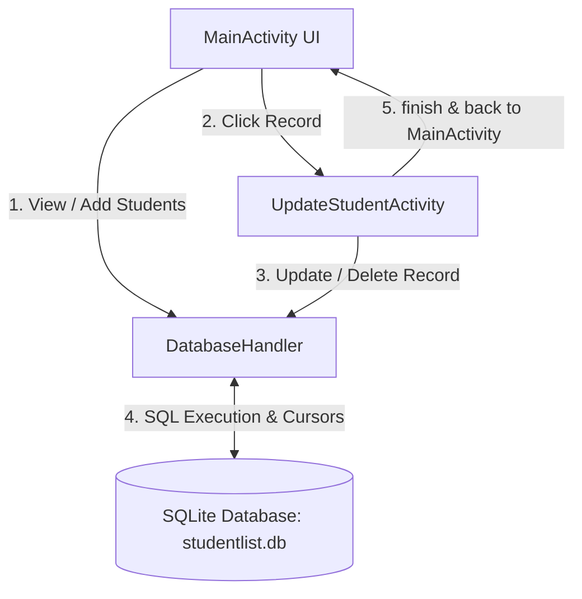

# Step-by-Step Guide: Working with SQLite in Android

> [!NOTE]
> This presentation walks through how SQLite is implemented in this Android project using standard Java, `SQLiteOpenHelper`, `ContentValues`, and `Cursor`.

---

## Slide 1: Overview & Architecture

SQLite is a lightweight, serverless, zero-configuration relational database embedded directly into Android.

### Application Data Flow



### Core Components
1. **Model Class** ([StudentList.java](file:///C:/Users/Ster/Desktop/MyApplication/app/src/main/java/com/example/myapplication/StudentList.java)): Data structure representing a single record (id, name).
2. **Database Helper** ([DatabaseHandler.java](file:///C:/Users/Ster/Desktop/MyApplication/app/src/main/java/com/example/myapplication/DatabaseHandler.java)): Handles SQLite database connection, table creation, upgrades, and CRUD queries.
3. **Main Screen** ([MainActivity.java](file:///C:/Users/Ster/Desktop/MyApplication/app/src/main/java/com/example/myapplication/MainActivity.java)): Displays records in a list and allows inserting new records.
4. **Update Screen** ([UpdateStudentActivity.java](file:///C:/Users/Ster/Desktop/MyApplication/app/src/main/java/com/example/myapplication/UpdateStudentActivity.java)): Modifies or deletes existing records and returns to the main list.

---

## Slide 2: Step 1 — Create the Model Class (`StudentList`)

The model class encapsulates table data into a Java object with getters and setters.

```java
package com.example.myapplication;

import androidx.annotation.NonNull;

/**
 * Model class representing a Student entity stored in the SQLite database.
 */
public class StudentList {
    // Database primary key ID
    private int _id;
    // Student name field
    private String _name;

    // Default empty constructor
    public StudentList() { }

    // Constructor with ID and Name (used when reading from database)
    public StudentList(int id, String name) {
        this._id = id;
        this._name = name;
    }

    // Constructor with Name only (used when creating a new record before ID generation)
    public StudentList(String name) {
        this._name = name;
    }

    // Getter and Setter for Student ID
    public int getID() { return this._id; }
    public void setID(int id) { this._id = id; }

    // Getter and Setter for Student Name
    public String getName() { return this._name; }
    public void setName(String name) { this._name = name; }

    // Formatted string representation displayed in the ListView adapter
    @NonNull
    @Override
    public String toString() {
        return "ID: " + _id + " | Name: " + _name;
    }
}
```

> [!TIP]
> Overriding `toString()` allows `ArrayAdapter<StudentList>` to automatically render readable item labels in Android's `ListView`.

---

## Slide 3: Step 2 — Define `DatabaseHandler` (`SQLiteOpenHelper`)

Extend `SQLiteOpenHelper` to manage database initialization and schema setup.

```java
public class DatabaseHandler extends SQLiteOpenHelper {

    // Database configuration constants
    private static final int DATABASE_VERSION = 1;
    private static final String DATABASE_NAME = "studentlist";
    private static final String TABLE_STUDENTS = "students";

    // Column names
    private static final String KEY_ID = "id";
    private static final String KEY_NAME = "name";

    // Constructor to pass context and database details to SQLiteOpenHelper
    public DatabaseHandler(Context context) {
        super(context, DATABASE_NAME, null, DATABASE_VERSION);
    }

    // Called when the database is created for the first time
    @Override
    public void onCreate(SQLiteDatabase db) {
        // SQL statement to create the students table with auto-incrementing ID
        String CREATE_STUDENTS_TABLE = "CREATE TABLE " + TABLE_STUDENTS + "("
                + KEY_ID + " INTEGER PRIMARY KEY AUTOINCREMENT,"
                + KEY_NAME + " TEXT"
                + ")";
        db.execSQL(CREATE_STUDENTS_TABLE);
    }

    // Called when upgrading the database (e.g. incrementing DATABASE_VERSION)
    @Override
    public void onUpgrade(SQLiteDatabase db, int oldVersion, int newVersion) {
        // Drop older table if it exists
        db.execSQL("DROP TABLE IF EXISTS " + TABLE_STUDENTS);
        // Recreate tables
        onCreate(db);
    }
}
```

---

## Slide 4: Step 3 — CRUD Operations Implementation

### Summary of CRUD Operations

| Operation | Method | Key SQLite Methods Used |
| :--- | :--- | :--- |
| **Create (Insert)** | `addStudent(StudentList student)` | `db.insert(TABLE_STUDENTS, null, values)` |
| **Read (Select All)** | `getAllStudentList()` | `db.rawQuery("SELECT * FROM ...", null)` + `Cursor` |
| **Read (Select One)** | `getStudent(int id)` | `db.query(TABLE_STUDENTS, ...)` + `Cursor` |
| **Update** | `updateStudent(StudentList student)` | `db.update(TABLE_STUDENTS, values, "id = ?", ...)` |
| **Delete** | `deleteStudent(StudentList student)` | `db.delete(TABLE_STUDENTS, "id = ?", ...)` |

---

## Slide 5: Deep Dive — Inserting Data (`CREATE`)

Use `ContentValues` to pair column names with target values:

```java
// CREATE: Inserts a new student record into the database
public void addStudent(StudentList student) {
    SQLiteDatabase db = this.getWritableDatabase();

    // Create key-value pairs matching column names and values
    ContentValues values = new ContentValues();
    values.put(KEY_NAME, student.getName());

    // Insert row and close database connection
    db.insert(TABLE_STUDENTS, null, values);
    db.close();
}
```

---

## Slide 6: Deep Dive — Querying Data (`READ`)

Use `rawQuery` and a `Cursor` object to iterate through records returned by SQLite:

```java
// READ (All Records): Fetches all student records into a List
public List<StudentList> getAllStudentList() {
    List<StudentList> studentList = new ArrayList<>();
    String selectQuery = "SELECT * FROM " + TABLE_STUDENTS;

    SQLiteDatabase db = this.getWritableDatabase();
    Cursor cursor = db.rawQuery(selectQuery, null);

    // Iterate through cursor rows and populate list
    if (cursor.moveToFirst()) {
        do {
            StudentList student = new StudentList();
            student.setID(Integer.parseInt(cursor.getString(0))); // id column index 0
            student.setName(cursor.getString(1));                // name column index 1
            studentList.add(student);
        } while (cursor.moveToNext());
    }
    cursor.close(); // Always close cursors after use
    return studentList;
}
```

---

## Slide 7: Deep Dive — Updating Data (`UPDATE`)

Update rows matching specific WHERE conditions using parameter placeholders (`?`) to prevent SQL injection:

```java
// UPDATE: Updates an existing student's details in the database
public int updateStudent(StudentList student) {
    SQLiteDatabase db = this.getWritableDatabase();

    ContentValues values = new ContentValues();
    values.put(KEY_NAME, student.getName());

    // Update matching row by ID
    int count = db.update(TABLE_STUDENTS, values, KEY_ID + " = ?",
            new String[] { String.valueOf(student.getID()) });
    db.close();
    return count;
}
```

---

## Slide 8: Deep Dive — Deleting Data (`DELETE`)

Delete rows matching the target record ID:

```java
// DELETE: Removes a single student from the database
public void deleteStudent(StudentList student) {
    SQLiteDatabase db = this.getWritableDatabase();
    // Delete row where column ID matches student ID
    db.delete(TABLE_STUDENTS, KEY_ID + " = ?",
            new String[] { String.valueOf(student.getID()) });
    db.close();
}
```

---

## Slide 9: Step 4 — Connecting Database to `MainActivity`

```java
// 1. Initialize database helper
db = new DatabaseHandler(this);

// 2. Seed initial sample data if database is empty on first launch
if (db.getStudentListCount() == 0) {
    db.addStudent(new StudentList("A"));
    db.addStudent(new StudentList("B"));
}

// 3. Item click listener: launch UpdateStudentActivity with intent extras
lvStudents.setOnItemClickListener((parent, view, position, id) -> {
    StudentList clickedStudent = (StudentList) parent.getItemAtPosition(position);
    Intent intent = new Intent(MainActivity.this, UpdateStudentActivity.class);
    intent.putExtra("STUDENT_ID", clickedStudent.getID());
    intent.putExtra("STUDENT_NAME", clickedStudent.getName());
    startActivity(intent);
});

// 4. Auto-refresh student list in onResume when returning from Update screen
@Override
protected void onResume() {
    super.onResume();
    refreshStudentList(); // Reloads all student records from SQLite
}
```

---

## Slide 10: Step 5 — Updating Data on the Second Screen (`UpdateStudentActivity`)

```java
// Retrieve student ID and Name passed via Intent extras
Intent intent = getIntent();
studentId = intent.getIntExtra("STUDENT_ID", -1);
studentName = intent.getStringExtra("STUDENT_NAME");

// Save Update button: updates student in SQLite and finishes activity
btnSaveUpdate.setOnClickListener(v -> {
    String updatedName = etUpdateName.getText().toString().trim();
    StudentList student = new StudentList(studentId, updatedName);
    db.updateStudent(student); // Call SQLite update method
    Toast.makeText(this, "Student updated successfully", Toast.LENGTH_SHORT).show();
    finish(); // Return back to MainActivity
});

// Delete button: deletes student from SQLite and finishes activity
btnDeleteStudent.setOnClickListener(v -> {
    StudentList student = new StudentList(studentId, studentName);
    db.deleteStudent(student); // Call SQLite delete method
    Toast.makeText(this, "Student deleted successfully", Toast.LENGTH_SHORT).show();
    finish(); // Return back to MainActivity
});
```

---

## Slide 11: Summary & Best Practices

> [!IMPORTANT]
> **Best Practices when using SQLite in Android:**
> 1. **Always close Cursors**: Free cursor memory using `cursor.close()` after query execution.
> 2. **Use Where Arguments (`?`)**: Never concatenate user input directly into SQL strings; use parameterized queries to protect against SQL injection.
> 3. **Manage Lifecycle**: Reload fresh data in `onResume()` when navigating back from secondary editing screens.
> 4. **Use Primary Keys**: Mark ID columns as `INTEGER PRIMARY KEY AUTOINCREMENT` for automatic unique ID management.
